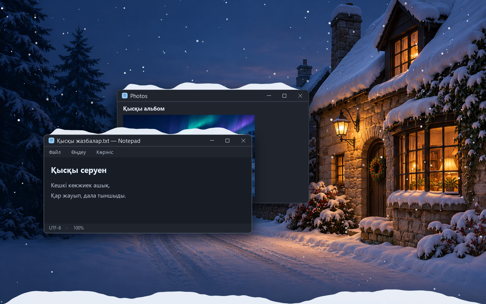
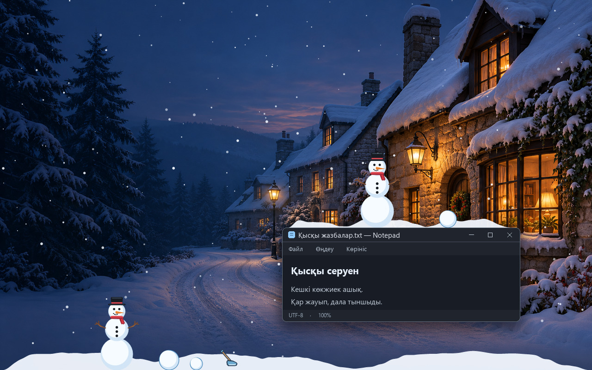
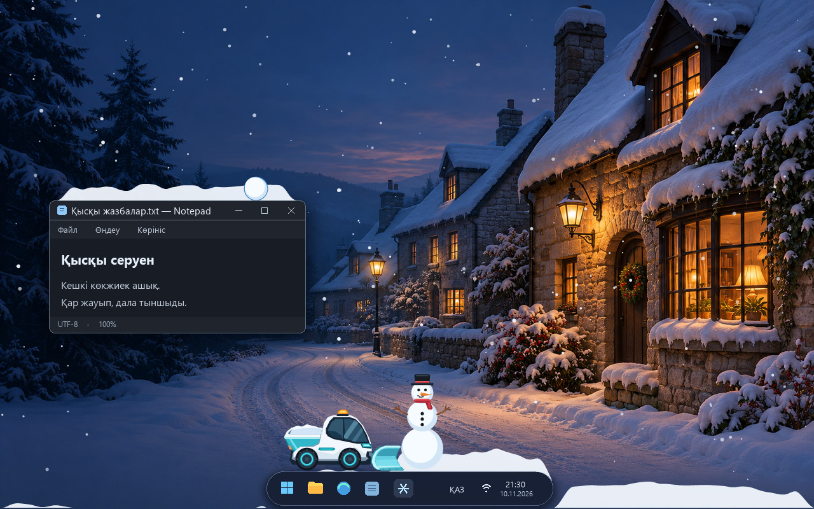
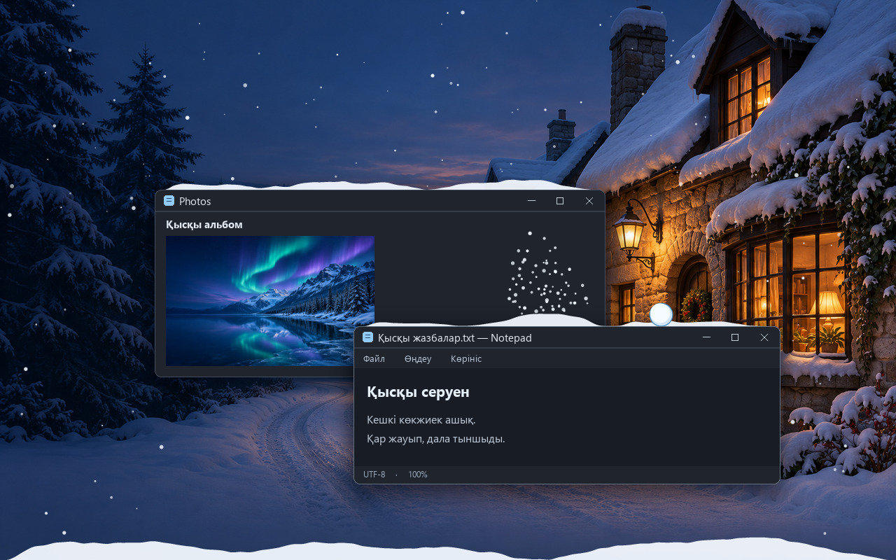

# Қысқы дала

Windows 10/11 жұмыс үстелінің бос жерлерінде қар жауады. Қар көрініп тұрған терезе жиектеріне және жұмыс үстелінің ашық төменгі жиегіне жиналады. Қарды күрекпен бір жерге үйіп, одан шар домалатып, аққала құрастыра аласыз.

Терезені жылжытқанда үйінді екпінмен сырғиды. Қар кесектері жиектен асып түсіп, төмендегі терезеге не жұмыс үстелінің төменгі жиегіне қонады. Тірегі тайған аққала тұтас құлайды. Қысқа құлаған шарды қайта ұстауға болады. Биіктен құлаған шар мен аққаланың қары майда қар болып түсіп, бір дөңгелек төбешікке жиналады.

Терезе жабылғанда, үстіндегі көрініп тұрған үйінді енін және пішінін сақтап төмен түседі. Төмендегі терезе үйіндінің бір бөлігін ұстаса, қалған бөлігі жұмыс үстеліне қарай түсе береді.

## Іске қосу

[Соңғы шығарылым](https://github.com/promaladoi/QysqyDala/releases/latest) бетінен `QysqyDala.exe` файлын жүктеп, ашыңыз. Бұл Windows x64 жинағы. Python оның құрамында бар және EXE бірден іске қосылады. Бұл жинаққа цифрлық қолтаңба қойылмаған.

Бастапқы кодтан іске қосу үшін Windows жүйесіне [Python 3.10 немесе жаңарақ нұсқасын](https://www.python.org/downloads/windows/) орнатып, жоба бумасында PowerShell ашыңыз.

```powershell
python .\snow_effect.py
```

Іске қосуға Python-ның стандартты кітапханасы жеткілікті. Егер компьютерде Python іске қосқышы `py` арқылы ашылса, `py .\snow_effect.py` пәрменін қолданыңыз.

## Көріністер

Қар әсерлері қолданбаның өзінен алынған. Тұсқағаз бен терезелер көрсетілім үшін таңдалған.

| Терезе жиектеріне жиналған қар | Аққала, шарлар және қол күрегі |
| --- | --- |
|  |  |

| Автоматты қар тазалағыш | Соққыдан кейін жиналып жатқан үйінді |
| --- | --- |
|  |  |

## Басқару

Қар автоматты түрде орташа қарқынмен жауа бастайды. Тапсырмалар тақтасында, сағаттың жанында орналасқан қар ұлпасын оң жақ батырмамен басыңыз. Белгі көрінбесе, `^` көрсеткісін басып, жасырын белгілерді ашыңыз.

- **Қар қарқындылығы** мәзірінен **Баяу**, **Орташа** немесе **Қалың** деңгейін таңдаңыз.
- **Аққала жасау режимі** арқылы қар жинау режимін қосыңыз немесе өшіріңіз. Таңдауыңыз сақталып, қолданбаны қайта ашқанда қалпына келеді.
- **Қар күрегі** арқылы қарды жиек бойымен ысыратын режимді қосыңыз немесе өшіріңіз.
- **Кідірту** қарды, үйінділерді және аққалаларды тазартады. **Қарды қосу** қар жаууын қайта бастайды.
- **Шығу** қолданбаны жабады.

Бір Windows сеансында «Қысқы даланың» бір ғана данасы іске қосылады.

## Қар күрегі

1. Сағат жанындағы мәзірден **Қар күрегі** тармағын таңдаңыз. Бір құралды қосқанда екіншісі өшеді. Күректі бағдарлама қайта ашылғанда мәзірден қайта таңдауға болады.
2. Жиналған қардың үстінде тінтуірдің **негізгі батырмасын** (әдетте сол жақ) басып тұрыңыз. Жиек бойымен оңға не солға сүйреңіз. Кішкентай күрек меңзерге ілесіп, қарды сол бағытта үйеді.
3. Күреуді аяқтау үшін батырманы жіберіңіз. Үйілген қардан шар жасау үшін **Аққала жасау режимін** таңдаңыз. Күрек режимі қосулы кезде, оны өшіру үшін **Қар күрегі** тармағын қайта таңдаңыз.

Күрек өзі өткен жолдағы қарды толық тереңдігімен ысырады. Үйінді толып тұрса, алға сыймаған қар кесек болып ұшады. Терезе үстіндегі қарды жерге түсіру үшін оны сол не оң шетінен асыра күреңіз. Жолда ашық жиек кездессе, кесек соған қонуы мүмкін. Қойылған шарлар мен аққалалар күрек режимінде сақталады.

## Автоматты қар тазалағыш

Төменгі жиектің кемінде 60%-ында қардың қалыңдығы 12 пиксельге жетіп, солай 5 секунд тұрса, ақ-көгілдір электр машинасы бір шеттен шығады. Машина жердегі қарды күрегі тиген жерден тазалайды, жолындағы шарлар мен аққалаларды жинап, екінші шеттен шығып кетеді. Машина өткен жерге қар бірден қайта жинала бастайды.

Келесі айналымға дейін кемінде 2 минут өтеді. Қар күрегін қолданғанда машина кідіреді. Машинаның күрегі сүйреп жүрген шарға немесе аққалаға тисе, оны ұстап тұрған жеріңізден алып, экран шетіне дейін итереді. Аққаланың пішіні сақталады.

Тапсырмалар панелі ашық болса, машина алдымен оның алдындағы қарды күрейді, содан кейін жиегіне жеткенде көтеріліп, панель үстіндегі қарды, шарлар мен аққалаларды жинайды. Панель жолай жасырылса, машина ілгері жүре отырып, итеріп бара жатқан шарымен не аққаласымен бірге төменгі жиекке бірқалыпты түседі.

## Аққала жасау

1. Сағат жанындағы мәзірден **Аққала жасау режимін** қосыңыз. Режим қолданбаны қайта ашқанда да қосулы тұрады. Оны сол мәзірден өшіре аласыз.
2. Терезе жиегіне немесе жұмыс үстелінің төменгі жағына жиналған қардың үстінде тінтуірдің **негізгі батырмасын** (әдетте сол жақ) басып тұрыңыз. Меңзерді үйінді бойымен сүйрегенде, оған ілескен қар шары үлкейеді.
3. Домалатқан іздегі үйінді жұқарады. Шар өзіңіз қалаған өлшемге жеткенде, оны ашық жиекке сүйреп апарып, батырманы жіберіңіз.
4. Шарларды бөлек қоюға немесе кішірек шарды тұрған шардың дәл үстіне қоюға болады. Қойылған шарды қайта ұстап үлкейтуге, ал аққаланың ең үстіңгі шарын қайта сүйреуге болады.
5. Бір шарды ұстап, жиек бойымен басқа шардың бүйіріне сүйреңіз. Итерілген шар екпінмен домалайды. Жиектен асып кетсе, төмендегі ашық терезе жиегіне немесе жұмыс үстеліне құлайды. Қысқа құлаудан кейін оны қайта ұстап, аққалаға қоса аласыз.
6. Жиналған аққаланы тұтас көшіру үшін **ең төменгі шарын** басып тұрып сүйреңіз. Табанын басқа терезенің бос жоғарғы жиегіне тақап, батырманы жіберіңіз. Ауада жіберсеңіз, аққала төмен құлайды. Жұмсақ қонса, пішіні сақталады.
7. Шарды немесе тұтас аққаланы лақтыру үшін меңзерді тез сермеп, сол қимылда тінтуір батырмасын жіберіңіз. Соққыда екеуінің де пішінінен майда ұлпалар сәл жоғары және жан-жаққа тарайды. Алғашқы ұлпалар қона бастағанда төбешік өседі. Қалған ұлпалар соған түсіп, екі дененің қар көлеміне сай бір төбешік болып жиналады.

Бөлек шардың және аққала табанының өлшемін жиналған қар анықтайды. Үстіңгі шарлар қойылғанда, пішіні табанға қарай біркелкі кішірейеді. Бір шардың ең үлкен диаметрі 72 экран пикселі. Бірінің үстіне бес шарға дейін қоюға, ал жұмыс үстелінде 24 бөлек шар немесе мұнара ұстауға болады. Жалғыз шардың көк жиегі оны үйіндіден ажыратуға көмектеседі.

Үш шарды немесе одан көбін жинағанда, аққалаға қара қалпақ, қызыл шарф, сәбіз мұрын, бұтақ қолдар және қара түймелер көрінеді. Үстіңгі шарды қайта ұстау үшін қардың өзін басыңыз. Қардан сыртқа шығып тұрған әшекейлердің үстінен тінтуір басуы астындағы терезеге өтеді.

Режимді өшіргенде қойылған шарлар мен аққалалар сақталады. Тінтуір басулары қайтадан түгелдей мөлдір қабаттың астындағы нысандарға өтеді.

## EXE жинау

Жинауды Windows жүйесінде, CPython 3.10.1–3.15 орнатылған ортада орындаңыз. EXE архитектурасы қолданылған Python архитектурасына сәйкес келеді. Алғашқы жинау үшін интернет қажет.

```powershell
powershell -NoProfile -ExecutionPolicy RemoteSigned -File .\build.ps1
```

Скрипт `.build` бумасында оқшауланған жинау ортасын құрып, оған [PyInstaller 6.22.3](https://pypi.org/project/pyinstaller/6.22.3/) орнатады. Нәтиже `dist\QysqyDala.exe` жолына жазылады. Басқа Python нұсқасымен не архитектурасымен жинағанда `-Python` параметріне тиісті `python.exe` жолын, `-BuildDirectory` параметріне жаңа бума жолын беріңіз.

## Жұмыс істеу тәртібі

Қолданба экрандар мен ашық терезелердің шекарасын Windows API арқылы оқып, қарды GDI+ көмегімен мөлдір қабатқа салады. Ұшқан қар жұмыс үстелінің ашық бөлігінде көрінеді. Терезе жиегіндегі үйінді мен шарлар сол терезенің қабат ретіне ілеседі. Сондықтан алдыңғы терезенің жиегіндегі қар артқы терезенің үстінен көрінеді, ал жиекті алдыңғы терезе жапса, қар да жасырылып тұрады. Аққала жасау режимінде жиналған қар мен шарларды ұстай аласыз. Күрек режимінде үйілген қарды ғана ұстайсыз. Қалған жерлерде басулар қабаттың астындағы нысандарға өтеді.

Windhawk WindowGlass қалқымалы тақтасының көрінетін өлшемі Windows арқылы оқылады. Тақта ашылғанда, оның тұсындағы қар мен аққалалар дөңгелек пішінінің бойымен көтеріледі. Екі жақтағы қар экранның төменгі жағында қалады. Тақта жасырылғанда, көтерілген бөлік те төмен түседі. Терезе үстіндегі үйінді тегіс жиекте аяқталып, дөңгеленген бұрыштардан асып тұрмайды.

Экрандағы қар монитор жиілігіне сай секундына шамамен 30 кадрмен жаңарады. Жүктеме артқанда бұл жиілік шамамен 20 кадрға төмендейді. Сүйреліп жатқан шар бөлек шағын қабатта жылдамырақ қозғалады. Терезені жылжытқанда немесе өлшемін өзгерткенде, жауып тұрған ұлпалар, қар үйінділері, шарлар және шашылған кесектер бір мөлдір қабатта салынады. Терезе орныққанда қарды тінтуірмен жинау қайта қосылады. Қозғалыс кадрлары 2 мс ішінде өңделсе, қар жиірек жаңара алады. Алдыңғы терезе жұмыс үстелін толық жапса, бағдарлама қарды есептеу мен салуды тоқтатып, жұмыс үстелінің қайта көрінгенін секундына 8 рет тексереді. Бағдарлама басқа қолданбаларға процессор басымдығын береді және жергілікті жұмыс істейді.

`snow_effect.py` қолданбаны іске қосады. `win32.py` Windows API-мен жұмыс істейді, `simulation.py` қар ұлпалары мен үйінділердің қозғалысын есептейді, ал `render.py` эффектіні экранға салады. `snowman.py` шар жасау, жинау, домалау және соқтығысуды, `shovel.py` күрекпен қар ысыруды басқарады. Қозғалып жатқан шарлар қар ұлпаларымен бір қабатта салынады. Жоба [MIT лицензиясымен](LICENSE) таратылады.

## Тексеру және шектеулер

Windows 11 сынағында күрек қарды оңға және солға ысырып, жиналған қар көлемін сақтады. Тінтуір қимылдарын модельдеген Windows сынағында күрекпен үйілген қардан шар домалатылды. Бөлек сынақта қар ашық терезе шетінен төмен құлады, ал жабық аралықтар мен тапсырмалар тақтасының шекарасынан өтпеді.

Windows 11 Pro x64 жүйесінде бір 1920×1200 мониторда шарларды домалату, қою және қайта ұстау тексерілді. Тінтуір қимылын модельдеген сынақта үш шар қолдан жиналды. Төменгі шардың өлшемі сақталып, ортаңғы және жоғарғы шардың диаметрі табан диаметрінің тиісінше 73% және 53%-ына тең болды. Бөлек сынақта бір шар екіншісін жиектен итерді. Ол төменгі терезеге қонып, бастапқы өлшемімен қайта ұсталды.

1920×1200 экранда үлкен терезе, 850 қар ұлпасы және үш қозғалған шар бар сынақта әр кадрда Windows-қа жіберілетін сурет дерегі 8,77 МБ-тан 3,01 МБ-қа азайды (МБ мұнда 1024² байт). Сол көріністе қарды салу уақытының 95-процентилі 4,33 мс-тан 3,50 мс-қа түсті. Сүйреліп жатқан шардың орны қар кадры салынар алдында жаңарады. Жұмыс үстелі тұтас жабылғанда қар физикасы мен қабатты салу тоқтайтыны және қолданба секундына шамамен 8 рет оянатыны бөлек тексерілді.

1920×1200 экрандағы ашық жұмыс үстелінде сегіз классикалық аққала мен шамамен 963 қар ұлпасы бар 110 кадр салыстырылды. Бір кадрға жұмсалған процессор уақыты 8,95 мс-тан 7,39 мс-қа түсті. Тексерілген кадрлардың пиксельдері бұрынғы нұсқамен дәл сәйкес келді. 24 шар бір мезетте домалаған жеке сынақта шарлардың қозғалысын есептеу уақыты 0,46 мс-тан 0,23 мс-қа қысқарды.

1920×1200 экранда екі үлкен терезе, сегіз аққала және шамамен 672 қар ұлпасы бар 110 кадрлық сынақта Windows-қа жіберілген сурет дерегінің медианасы 10,14 МБ-тан 4,40 МБ-қа азайды (1024² байт). Бір кадрға жұмсалған процессор уақыты 7,24 мс-тан 6,11 мс-қа түсті. Тексерілген кадрлардың пиксельдері дәл сәйкес шықты.

Бос жолақтарды дәл тазарту және қозғалмай тұрған жиектердегі қону тексерістерін қысқарту бөлек өлшенді. Сол 1920×1200 көріністің жұпталған сынағында бір кадрға жұмсалған процессор уақыты 7,24 мс-тан 6,53 мс-қа түсті. Тексерілген кадрлардың пиксельдері дәл сәйкес шықты.

Келесі салыстыруда қар үйіндісінің өзгерген бөлігі ғана қайта есептеліп, қайта салынды. 1920×1200 экранда сегіз аққала, 672 ұлпа және қозғалмай тұрған терезелер бар 110 кадрда процессор уақыты 6,39 мс-тан 5,40 мс-қа, Windows-қа жіберілген сурет көлемінің медианасы 4,40 МБ-тан 3,11 МБ-қа түсті. Ашық жұмыс үстелі, қабаттасқан және қозғалған терезелер бар бөлек салыстыруларда кадрлар пиксель бойынша сәйкес шықты.

Бөлек Windows 11 сынағында тінтуірмен лақтырылған шар аққалаға соқты. Майда қар түсіп жатқанда жиектегі төбешік өсті. Қардың жалпы көлемі сақталды. Терезе жабылғанда үйіндінің бастапқы пішінімен түсуі және дөңгелек тақта жасырылғанда қар тазалағыштың аққаламен бірге төмендеуі де тексерілді.

Қабаттасқан екі Windows терезесінің ашық жиектерінде қар көрінді. Алдыңғы жиектен тінтуірмен қар жинап, сол жерге шар қою тексерілді. Артқы терезе бүкіл жұмыс аймағын жапқан сынақта да алдыңғы жиек көрінді. Үшінші тереземен жабылған жиек жасырылды.

Жасырылған WindowGlass тақтасының ені мен орны осы компьютерде өлшенді. Windows сынақ тақтасының 13 қалпында қар тек дөңгелек тақтаның тұсында қозғалды. Тақта аумағы бос қалып, қар көлемі сақталды. Explorer тақтасының нақты ашылу анимациясы, Windows 10, бірнеше физикалық монитор, аралас экран масштабы және эксклюзивті толық экран режимі тексерілмеді.

Қар терезе жиегінің үстінде бос орын бар жерге жиналады. Мөлдір қабат қалыпты Windows жұмыс үстеліне арналған. Құлыптау экраны және UAC растау экраны оның қолдау аясынан тыс.
